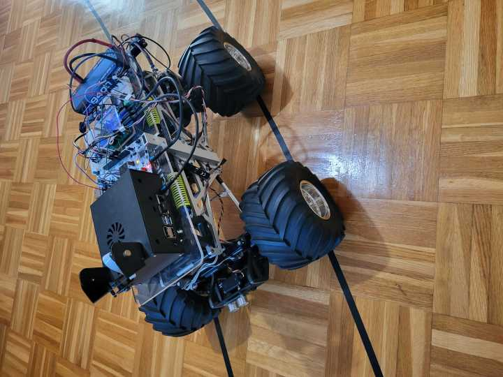
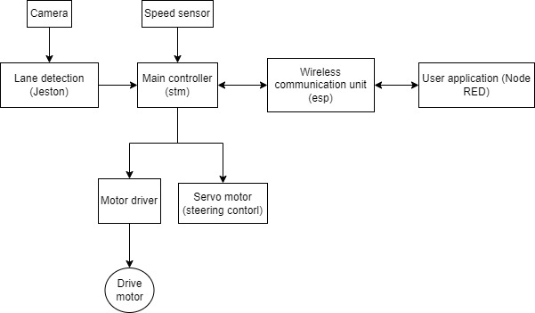

# Genesis Autonomous Vehicle

This project is part of the masters thesis. It implements the lane keep system based on the lane detection using nvidia jetson nano and raspberry pi camera. It features MPC controller for lateral (steering) control and PID controller for longitudinal (speed) control. 

## Top level schematic

## Folder structure
* Genesis_esp -> Code for esp32 receiving data from stm32 and dispatching it via mqtt.
* Genesis_jetson -> Submodule with implementation of lane detection on Jetson Nano.
* Genesis_stm -> Main controller, based on the stm32h755.
* NodeRED -> User application for communication and control of the vehicle.
